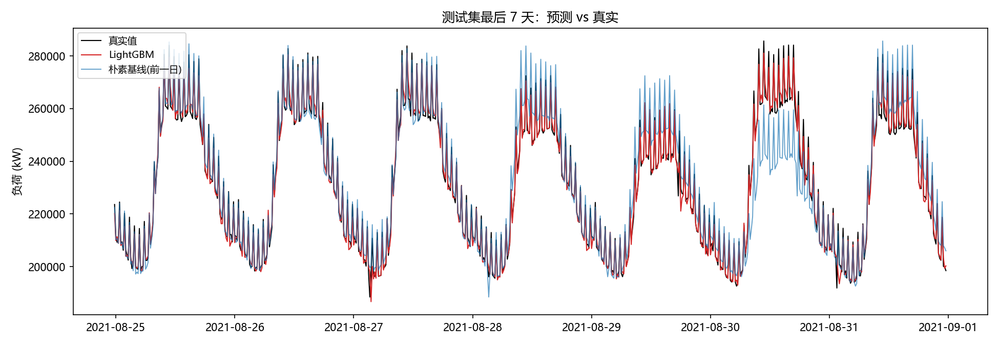
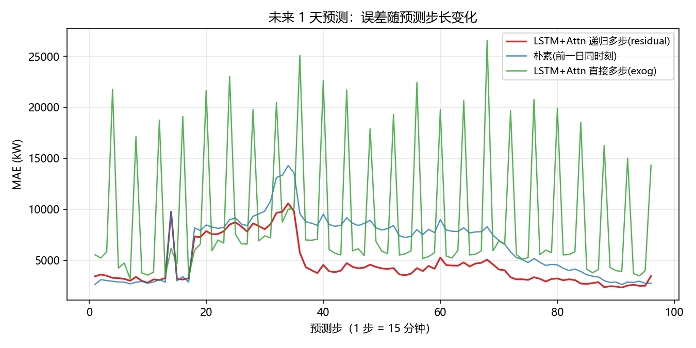
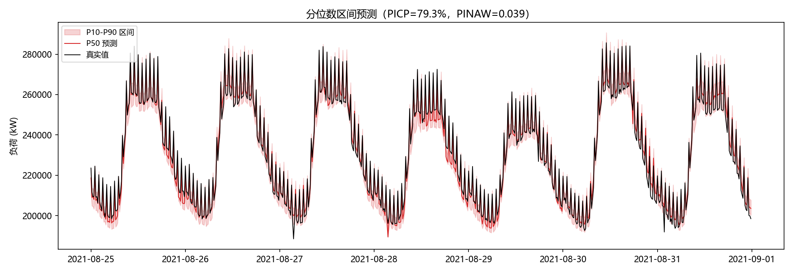

# 电力负荷时间序列预测（毕业设计）

> 用 **LSTM + 注意力机制** 做 15 分钟粒度电力负荷的多步预测，并与季节朴素基线、LightGBM 做严格对照；覆盖单步 / 多步 / 递归 / 残差 / 区间预测 / 跨数据集泛化 / Streamlit 原型。

## 一页概览

**数据**：某地区 2018–2021 年 15 分钟负荷（105,216 个训练点）+ 同期气象数据。严格按时间切分，标准化统计量只用训练集：

    ｜ 训练 2018-01-01 ~ 2020-12-31（105,216 点）｜ 验证 2021 上半年（17,376 点）｜ 测试 2021-07~08（5,952 点）｜

**方法**：9 通道外生特征输入（负荷 + 时段 sin/cos + 星期 sin/cos + 周末 + 节假日 + 最高/最低温）、LSTM + 加性注意力、损失函数工厂（MSE / MAE / Huber / 分位数）、残差建模（预测 Δ = y(t+h) − y(t+h−96)）、递归与直接多步两条路线。

**核心结果**（测试集，单位 kW）

| 实验 | 方法 | MAE | MAPE |
|---|---|---|---|
| 单步 h=1 | LightGBM（滞后+日历+气象） | **2,744** | 4.11% |
| 单步 h=1 | LSTM + 注意力（外生特征） | 3,826 | **2.89%** |
| 单步 h=1 | 朴素-前一周同时刻 | 5,586 | 8.09% |
| 未来 1 天（61 个起点） | **LSTM 递归 + 残差** | **4,583** | — |
| 未来 1 天（61 个起点） | 朴素-前一日同时刻 | 6,492 | — |
| 未来 1 天（61 个起点） | LSTM 直接多步（单变量） | 9,249 | — |
| 区间预测（80%） | 分位数损失 LSTM | PICP **79.27%** / PINAW 0.039 | — |

**三个可写进论文的结论**

1. 单变量 LSTM 多步**不如朴素基线**——必须引入外生特征，神经网络才具备竞争力；
2. 递归多步优于直接多步，残差建模进一步把 96 步整体 MAE 从 5,295 降到 4,583；
3. 评估必须用「每日起点、非重叠」口径：重叠滑窗会把边界误差（14.1k）平均成看似更好的 7.9k。

**关键图**：`results/figs/`

**代码结构**：`config.py` 统一路径与超参 · `data_utils.py` 特征与切分 · `models_lstm_attn.py` 网络与损失 · `models_baseline.py` 朴素与 LightGBM · `run_*.py` 各实验入口 · `app.py` Streamlit 原型。

**数据说明**：原始负荷与气象数据不在本仓库（约 100MB，且受数据来源限制）。`results/` 中保留了全部指标 CSV、模型权重与图表，可按 README 第三节口径用自有数据复现。

---

# 电力负荷时间序列预测 · PyCharm 工程

课题：电力负荷时间序列数据预测（毕业设计）
本工程 = 可运行的最小流程：数据读取 → 特征构造 → 基线对比 → LSTM+注意力 → 指标与图。

数据位置（只读，与工程分开）：
    D:/电力负荷预测毕设数据/raw

---

## 一、在 PyCharm 里开始训练（5 步）

**第 1 步：打开工程**
PyCharm → File → Open → 选择文件夹 D:/电力负荷预测毕设 → Trust Project

**第 2 步：配置解释器（只需一次）**
File → Settings（Ctrl+Alt+S）→ Project: 电力负荷预测毕设 → Python Interpreter
→ 齿轮/Add Interpreter → Add Local Interpreter → System Interpreter
→ 选择 D:/Anaconda3/python.exe → OK
（该解释器已装好 numpy / pandas / lightgbm / torch / matplotlib，无需再装）

**第 3 步：先跑基线（2 秒出结果）**
项目树里右键 run_e1.py → Run 'run_e1'
控制台会打印对比表；results/ 下生成 e1_metrics.csv，results/figs/ 下生成 3 张图。

**第 4 步：训练 LSTM + 注意力**
右键 run_lstm.py → Run 'run_lstm'
默认 20 个 epoch，CPU 约 10 分钟（会自动早停）。
想先快速试跑：Run → Edit Configurations → Parameters 填：
    --epochs 3 --max-train 60000
（约 1 分钟）

**第 5 步：看结果**
results/figs/ 下：
    e1_prediction_vs_truth.png    基线预测对比（最后 7 天）
    e1_feature_importance.png     LightGBM 特征重要性
    e1_residual_hist.png          残差分布
    lstm_prediction_vs_truth.png  LSTM+Attention 预测对比
    lstm_attention_heatmap.png    注意力权重（模型关注哪些历史时点）

---

## 二、文件说明

| 文件 | 作用 |
|---|---|
| config.py | 所有路径与超参：数据路径、切分时间、回看长度、预测步长 |
| data_utils.py | 读取负荷/气象、补缺失、构造滞后与日历特征、滑窗、时间切分 |
| metrics.py | MAE / RMSE / MAPE / sMAPE 计算与表格输出 |
| models_baseline.py | 季节朴素 + LightGBM（带验证集早停） |
| models_lstm_attn.py | LSTM + 加性注意力网络；损失函数工厂（mse/mae/huber/quantile） |
| run_e1.py | 实验 E1：朴素基线 vs LightGBM |
| run_e2.py | 实验 E2：多步预测对比（h = 1 / 4 / 96 步） |
| run_recursive.py | 实验 E2b：用 LSTM h=1 模型递归滚动预测未来 1 天（对比直接多步） |
| run_lgbm_recursive.py | 实验 E2c：用 LightGBM h=1 模型递归滚动预测未来 1 天（公平对比） |
| run_blend.py | 实验 E7：朴素基线 + 残差 LSTM 递归的组合预测（全局权重 / 逐步长权重） |
| run_opsd.py | 实验 E6：跨数据泛化——在 OPSD 欧洲小时级负荷上复跑 LightGBM + 朴素基线 |
| app.py | 原型系统（Streamlit）：选日期 + 选模型 → 未来 1 天预测曲线、区间、误差指标 |
| run_lstm.py | 训练 LSTM+Attention（默认多通道外生特征；可指定步长 h、损失函数、特征模式） |
| results/ | 指标 CSV、模型权重、图片 |

---

## 三、切分口径（已固定，勿改）

    训练：2018-01-01 ~ 2020-12-31   （105,216 点）
    验证：2021-01-01 ~ 2021-06-30   （ 17,376 点）
    测试：2021-07-01 ~ 2021-08-31   （  5,952 点）

严格按时间顺序，禁止随机打乱；标准化只用训练集统计量。

---

## 四、当前实测结果

### E1 单步（提前 15 分钟）

| 模型 | MAE (kW) | RMSE (kW) | MAPE |
|---|---|---|---|
| LightGBM（滞后+日历+气象+节假日） | 2,744.2 | 7,166.4 | 4.11% |
| 朴素-前一周同时刻 | 5,586.0 | 15,452.0 | 8.09% |
| 朴素-前一日同时刻 | 6,474.3 | 16,539.7 | 8.23% |
| 朴素-前一时刻 | 10,246.5 | 13,870.4 | 4.45% |

### E2 多步（LightGBM 直接多步 vs 朴素）

| 提前量 | LightGBM MAE | 朴素(前一周同时刻) MAE |
|---|---|---|
| h=1（15 分钟） | 2,744.2 | 5,586.0 |
| h=4（1 小时） | 2,975.3 | 5,588.6 |
| h=96（1 天） | 4,118.0 | 5,586.7 |

解读：
1. 单步预测 LightGBM 明显强于朴素基线；提前量越大误差越大（符合规律）。
2. 神经网络（LSTM+Attention）单变量单步约 4,000~4,600 kW，介于朴素与 LightGBM 之间；
   **论文的增益点应放在多步、多变量、区间预测和注意力可解释性上**，而不是硬拼单步精度。
3. LSTM 直接多步（h=96，40 epoch，单变量）：
   - 平均 MAE 8,749 kW（96 步平均）；第 96 步 MAE 9,439 kW
   - 同一提前量下 LightGBM 为 4,118 kW、朴素基线 5,586 kW → **单变量 LSTM 甚至不如朴素基线**
   原因：① 输入只有 96 个历史负荷值，没有星期/时段/节假日/温度等外生特征；
         ② 一个网络同时输出 96 步，容量被摊薄；③ 注意力仍集中在序列最前几步。
   **结论：多步实验必须给神经网络加入外生特征（多通道输入），否则与 GBDT 不可比。**

4. 递归多步（用 h=1 模型滚动 96 步，61 个 0 点起点）：
   - 单变量模型：整体 MAE 7,426 kW，不如朴素基线（6,492）
   - **外生特征模型：整体 MAE 5,295 kW，首次超过朴素基线（6,492）**；第 8~24 小时误差 7,800~8,000 kW
   分步看：加入时段/星期/节假日/温度后，模型能维持日周期，不再中途崩塌。
   **结论：多步预测中神经网络必须有多通道外生特征输入，才可能与 GBDT 竞争。**

5. 单步：外生特征 LSTM 的测试集 MAE 3,661 kW（单变量版本为 4,056），仍低于 LightGBM 的 2,744。

6. **统一口径下的未来 1 天预测（61 个每日 0 点起点，滚动/直接 96 步）**：

| 方法 | 全部 96 步平均 MAE | 第 96 步（24h 后）MAE |
|---|---|---|
| 朴素(前一日同时刻) | 6,492 | **2,743** |
| **LSTM+Attn 递归（外生特征）** | **5,295** | 3,295 |
| LightGBM 递归 | 6,422 | 5,690 |
| LightGBM 直接多步 | — | 4,153 |
| LSTM+Attn 直接多步（40 epoch） | 7,838（该子集） | 14,130 |

7. **残差建模（--residual）实测**：

| 方法 | 无残差 | 残差模式 |
|---|---|---|
| LightGBM 直接多步 h=96（全部窗口） | 4,118 | **3,830** |
| LightGBM 递归多步（61 起点） | 6,422 | 6,467（整体不变，第 96 步 5,690→3,765） |
| **LSTM+Attn 递归多步（61 起点）** | 5,295 | **4,583（当前最优）** |
| 朴素基线 | 6,492 | — |

结论：残差只在中长提前量（4 小时~20 小时）明显有效，短提前量反而变差；24 小时整点上朴素基线（2,743）仍最强。

9. **E5 区间预测（分位数损失，run_lstm.py --loss quantile）**：
   - 模型：外生特征 LSTM+Attention，输出 P10/P50/P90 三个分位数（80% 区间）
   - 测试集：**PICP = 79.27%**（名义 80%，校准良好）、**PINAW = 0.039**、平均区间宽度 ≈ 11,528 kW
   - P50 点预测 MAE = 4,237 kW（分位数损失优化分布，点精度略低于纯 MAE 模型 3,826，属正常现象）
   - 输出：results/interval_metrics.csv、results/figs/quantile_interval.png

8. **组合预测（run_blend.py，权重在验证集选择）**：

| 方法 | 测试集 MAE | 第 96 步 MAE |
|---|---|---|
| LSTM 残差递归（单模型） | **4,583** | 3,444 |
| 组合（逐步长权重） | 4,602 | **2,665（首次超过朴素）** |
| 组合（全局权重 w=0.40） | 5,159 | 2,883 |
| 朴素基线 | 6,492 | 2,743 |

结论：整体上组合没有超过单模型（残差递归 LSTM 已是最优）；但**逐步长加权在 24 小时整点（第 96 步）首次压过朴素基线**（2,665 vs 2,743），
可作为论文中"不确定性/整点预测"的讨论点。

结论：
- 递归多步 > 直接多步；直接多步模型在窗口边界步（第 96 步）严重失效，属于结构问题；
- 24 小时整点预测里，季节朴素基线极强（日周期稳定），任何模型都要以此为必须超越的线；
- **评估必须用"每日起点、非重叠"口径**，用重叠滑窗平均会把边界误差掩盖掉（本次就出现了整体 7.9k、边界 14.1k 的反差）。

---

## 五、常用命令（也可以在 PyCharm 的 Terminal 里跑）

    python run_e1.py
    python run_lstm.py                              # 默认：外生特征 + 单步
    python run_lstm.py --horizon 96 --epochs 40     # 未来 1 天（外生特征）
    python run_lstm.py --epochs 3 --max-train 20000 # 快速试跑
    python run_lstm.py --features load              # 退回单变量（仅历史负荷）
    python run_lstm.py --loss quantile              # 分位数损失（区间预测）

残差模式（--residual）：预测 Δ = y(t+h) − y(t+h−96)，最终预测 = 前一日同时刻 + Δ̂；
实测：LightGBM 直接 h=96 从 4,118 → **3,830**；LSTM 递归多步从 5,295 → **4,583**（整体最优）。

模型输入设计（--features exog，默认）：
    X  (B, 96, 9) = 归一化负荷 + 时段 sin/cos + 星期 sin/cos + 周末 + 节假日 + 最高/最低温
    FX (B, h, 6)  = 目标时刻的外生协变量（时段/星期/周末/节假日，未来已知，喂给解码器）
    Y  (B, h)     = 目标负荷
输出文件：results/lstm_h{h}_{features}_metrics.csv、results/figs/lstm_h{h}_{features}_per_step_mae.png

---

## 六、常见问题

1. 提示 ModuleNotFoundError: 解释器没选对，回到第 2 步选 D:/Anaconda3/python.exe。
2. 中文乱码：File → Settings → Editor → File Encodings 全部设 UTF-8，重启。
3. 训练太慢：默认全量 10 万窗口，先用 --max-train 40000 --epochs 3 验证流程。
4. 换数据：只改 config.py 里的 LOAD_CSV / WEATHER_CSV 路径。
5. 图片字体方块：代码已指定 Microsoft YaHei；若仍异常，把 plt.rcParams 改成 SimHei。
6. 报错 "OMP: Error #15 ... libiomp5md.dll already initialized"：conda 的 MKL 与 torch 的 OpenMP 冲突。run_lstm.py 已内置 KMP_DUPLICATE_LIB_OK=TRUE；若仍出现，在系统环境变量中新增 KMP_DUPLICATE_LIB_OK=TRUE 后重启 PyCharm。
7. PyCharm 运行时报 "No module named xxx"：解释器不是 D:/Anaconda3/python.exe，回到第 2 步重新选择。

---

## 六点五、跨数据泛化（E6，run_opsd.py）

在 OPSD 欧洲小时级负荷上复跑同一套方法（示例：德国 DE，2015-01 ~ 2020-09，小时级）：

    python run_opsd.py --country DE     # 或 FR / GB / IT 等

实测结果（测试集 2020-04 之后）：

| 模型 | MAE (MW) | MAPE |
|---|---|---|
| LightGBM | **794.5** | 1.62% |
| 朴素-前一周同时刻 | 2,137.0 | 4.40% |
| 朴素-前一日同时刻 | 3,881.4 | 7.81% |

结论：同一套特征工程 + LightGBM 在另一国家、另一种采样频率（1 h vs 15 min）上依然显著优于朴素基线，
说明方法具有跨数据泛化性；输出 results/opsd_metrics.csv、results/figs/opsd_prediction.png。

## 七、原型系统（Streamlit）

启动方式（任选）：
1. PyCharm 底部 Terminal 执行：`streamlit run app.py`
2. 或在 PyCharm 里为 app.py 建运行配置，脚本参数填：`run app.py --server.port 8501`

打开 http://localhost:8501 ，左侧可切换模型（残差 LSTM / 外生特征 LSTM / 分位数区间 LSTM）和预测日期（2021-07-01 ~ 2021-08-30），
页面展示未来 1 天预测曲线、朴素基线对比、P10-P90 区间（分位数模型）、MAE/RMSE/MAPE 指标和逐点误差表。

## 八、下一步路线（对应论文实验矩阵）

E2 多步预测：已提供 run_e2.py（LightGBM 直接多步）；LSTM 可跑 run_lstm.py --horizon 4 / 96
E3 损失函数：--loss mse / mae / huber / quantile，填对比表
E4 消融：去掉注意力（改 models_lstm_attn.py 用最后一帧隐藏状态）、去掉温度特征
E5 区间预测：--loss quantile 输出 P10/P50/P90，计算 PICP / PINAW
E6 跨数据泛化：把 OPSD / NESO 数据接入 config.py 复跑
原型系统：新增 app.py（Streamlit），选日期 → 预测曲线 + 区间